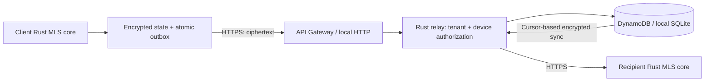

# Architecture and security boundaries

## Product direction

Croaker targets small/mid-size businesses, up to 1,000 seats per tenant and 500
users per group. The product will support hosted SaaS and independent customer AWS
accounts, enterprise SSO, external guests, and mobile/desktop clients sharing a
Rust core. Those product capacities are targets, not benchmarked guarantees. This
prototype caps relay conversations at **500 devices**, not 500 multi-device users.

The Lambda artifact depends on relay/protocol crates, not the crypto/client
crates. Decryption keys never belong on the relay. OpenMLS implements MLS;
Croaker does not invent a messaging cipher or claim Signal interoperability,
Signal's post-quantum properties, or Signal's metadata protections.

## Identity and authorization in this milestone

Operators register a tenant ID, device ID, role, and random 256-bit bearer token
using a local database or AWS IAM credentials. Only SHA-256 token digests are stored
for lookup. The public API cannot provision devices. Tokens are per device,
require HTTPS remotely, and remain valid until revoked; short-lived sessions,
enrollment approvals, and SSO are still to be implemented.

The server derives tenant and device identity from the credential registry, not
from request parameters. It checks active registration and conversation membership
for reads and writes. Append transactions recheck registration atomically with the
message write. Guests can participate in explicitly listed groups but cannot
create conversations or revoke other devices. Only the conversation owner may
submit welcome/commit events. Organization admins may revoke credentials within
their own tenant, but do not receive conversation decryption keys.

Every client key package is validated by OpenMLS, including its signature and
lifetime, then compared to a **pinned device binding**. Welcome rosters are checked
against pinned identities before joining. The demo passes these bindings directly
between its in-process clients, representing an out-of-band verification. A real
key directory must not silently treat server-provided public keys as verified.

Membership approvals are explicit. General commits are rejected by the application
message API. The implemented removal path requires a pinned authority and the
exact approved removed device; it rejects unrelated proposals. Adding members to
an established active group, concurrent commits, owner transfer, and automated
roster reconciliation still need their product workflows.

**Revoking server access is not cryptographic removal.** Remaining clients must
apply an MLS removal commit before sending sensitive new content. Previously
received history cannot be clawed back. The demo tests both credential revocation
and loss of access to newly rotated group keys.

## Delivery, retries, and storage

The public API uses `/v1` and carries protocol version 1. Encrypted event bytes are
base64-encoded and capped at 64 KiB decoded; HTTP request bodies are capped at
96 KiB. A sync page scans at most 32 events, keeping worst-case responses below
Lambda's synchronous payload limit. The current cursor is a numeric conversation
sequence, always interpreted within the authenticated tenant and conversation.

The relay stores each accepted event, its deduplication receipt, and the new
conversation sequence in one transaction. Repeating a sender/message ID with the
same envelope returns its original sequence. Changing the envelope returns 409.
DynamoDB serializes concurrent appends using conditional updates and bounded
retries. Clients must retry conflicts with backoff and the **same saved envelope**.

Welcome events are addressed to one device. Sync scans advance over events that
are not addressed to the caller or were sent by that same device; an empty visible
page can still have `has_more=true`. Continue with `next_cursor` until exhausted.
The relay uses pull-based catch-up; WebSockets, asynchronous fan-out, and push
delivery are not implemented yet. The prototypes do not require always-on compute
or a NAT gateway.

Server delivery payloads expire after 30 days. DynamoDB TTL removes event records
asynchronously; the application independently filters expiration. SQLite scrubs
expired payloads on its next operation while retaining deduplication metadata.
Idempotency receipts and conversation metadata currently persist indefinitely;
archival and complete tenant deletion remain future work. Point-in-time recovery
can preserve expired ciphertext longer than the live table's delivery window.

The client store encrypts its MLS state with XChaCha20-Poly1305 and a random key
that must ultimately live in OS secure storage. It commits state and outgoing
ciphertext together before exposing a pending send, using SQLite WAL and full
synchronous commits. Failed operations roll back the whole local transaction.
The client also stores encrypted inbound/outbound history. Incoming pages commit
MLS state, decrypted history encrypted under the local vault key, and the sync
cursor in one transaction. Failed authentication rolls back the whole page. The
local UI supplies a stable request ID for send retries so a repeated HTTP request
does not advance the ratchet or display the message twice.

## Local UI test harness

`croaker-local` serves the built React UI and `/local-api` from one loopback
address. The Rust process hosts independent Alice, Bob, and Maya client stores,
plus a ciphertext-only SQLite relay. Browser tabs select an account and exchange
plaintext with that **local client process**, which encrypts before interacting
with the relay. This is not browser-side E2EE or production device isolation.
The harness must never be used as the AWS backend.

The default private `data/ui/` directory holds the relay, separate encrypted client
databases, and a development manifest containing test credentials and vault keys.
This is an explicit development key-storage exception; production clients still
require OS secure storage and authenticated enrollment. The UI prominently labels
the workspace as local and explains these boundaries in “How to test”.

Requests to the local client bridge require a custom header, a loopback Host,
an absent or same-origin Origin, and a non-cross-site Fetch Metadata header. There
is no CORS permission for other origins. Responses disable caching and framing;
static assets are restricted to the UI build directory. Mutations accept bounded
JSON bodies. Attachments are capped at 32 KiB and included in the encrypted message
payload; SVG/HTML are not rendered as inline documents. They are not S3 uploads.

The harness pauses relay traffic per account when “Go offline” is selected. Sends
remain in the encrypted client state/outbox and flush on reconnection. Polling
syncs only the account being viewed, so inactive/offline accounts are not secretly
advanced by another tab. Fresh workspaces include seeded conversations to make
the UI immediately testable. Workspace metadata and messages persist across restart.

Reactions are encrypted MLS application events referencing the target message and
its original authenticated sender. Each reacting device publishes an absolute
emoji state (or null to remove it), so repeated requests cannot double a count.
The local bridge checks conversation access and that the target is an ordinary
message in that conversation. The client persists reaction events encrypted and
projects them into emoji counts; they never become chat rows, previews, or unread
messages. Existing message payloads and databases remain compatible.
The picker opens after a 500 ms stationary hold on a bubble, or through desktop
context-menu/keyboard access. Movement, scrolling, pointer cancellation, and early
release cancel the hold. Six common emoji appear first; a plus button opens a
searchable local catalog of 1,914 emoji with name/keyword matching. The expanded
catalog loads only when requested. The UI and Rust validator share the same bundled
catalog so non-default choices remain valid through sync and restart.

Typing signals also use encrypted MLS application events, containing only an
active flag and an expiry, never draft text. Active pulses are throttled to once
every two seconds, stop after browser inactivity/blur/send, and expire after six
seconds. Recipient clients authenticate them and commit the receive cursor and
ratchet without storing their plaintext in local history. Display state is held
only in memory, scoped to the conversation and authenticated device, and ordered
by relay sequence so delayed recipients cannot resurrect an older signal. Like
other MLS ciphertext, their encrypted relay records use the existing delivery
retention window; expiry refers to the indicator, not immediate transport deletion.

Device vaults contain live MLS secrets. They are **not** user recovery backups:
never roll one back after sending, clone it onto an active second device, or
implement recovery by copying its cryptographic state. The future backup format
must restore history and enroll a fresh device without resurrecting old ratchets.

## Threat model and release requirements

The foundation addresses passive network observation with TLS remotely; server-side
plaintext exposure through client encryption; cross-tenant reads/writes through
authorization; duplicate delivery through receipts; and modified/replayed MLS
messages through authenticated processing. Tests cover these boundaries but do
not constitute a security audit.

The service can see tenant/device identifiers, group rosters, sender routing,
timestamps, approximate sizes, access activity, and infrastructure network
metadata. It can suppress, delay, or reorder traffic. A malicious key directory
can attempt substitution, which is why pinned identity verification is required.
Compromised endpoints, stolen OS sessions, screenshots, malicious app updates,
traffic analysis, and availability attacks are outside these guarantees.

Before commercial release: complete enrollment/SSO and key verification; isolate
client secrets from UI permissions; implement safe recovery; add quota/abuse
controls, lifecycle/deletion workflows, backup
restore drills, dependency/license checks, signed distribution, performance/cost
measurements, and independent cryptographic/application security review. No
regulated-sector certification or compliance-export capability is claimed.

## AWS operational defaults

Terraform defaults to `us-east-1`, ARM64 Rust Lambda on `provided.al2023`, 256 MiB,
20-second function timeout, reserved concurrency 10, HTTP throttling of 25 requests
per second with a burst of 50, DynamoDB on-demand capacity/PITR/deletion protection,
and 14-day logs. These conservative prototype limits are not the eventual
100-message/second load target. The error alarm has no paging destination yet.
API access logs omit request paths, credentials, and bodies. Runtime logs are
limited to generic failures and must not enable SDK payload tracing.

The $200 monthly AWS budget is account-wide and optionally emails at 50%, 80%, and
100% actual usage. It does not stop resources or guarantee a maximum bill. Media,
video, replicated environments, and support will need separate cost measurements.
No cloud resources are created by unit tests or the Terraform mock test.
